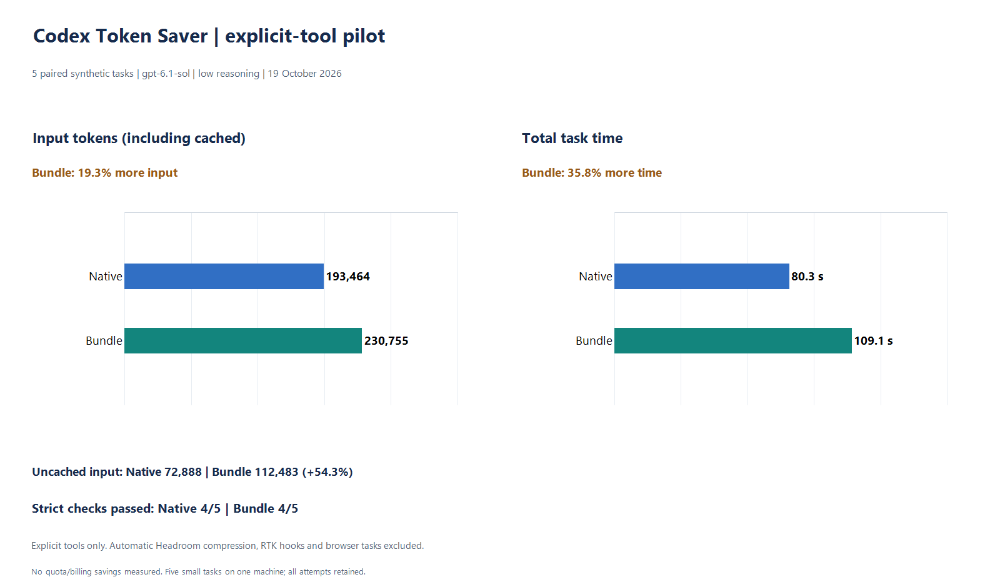

# Native Codex / Token Saver: explicit-tool pilot

Run started 2026-10-19T13:23:36.931578+00:00. Five synthetic paired tasks on one Windows laptop.
Requested model: `gpt-6.1-sol`; reasoning: `low`;
CLI: `codex-cli 0.163.0-alpha.10.2`; Windows: `10.0.26200` (AMD64).

[Raw results](coding-windows.json) · [Frozen tasks, hashes and rubric](coding-windows.manifest.json)

Configuration: **Explicit-tool pilot**.

## Results

| Task | Native grade | Bundle grade | Native input | Bundle input | Native seconds | Bundle seconds |
|---|---|---|---:|---:|---:|---:|
| log-diagnosis | Pass | Pass | 43,564 | 46,485 | 10.584 | 14.005 |
| symbol-tracing | Fail | Fail | 40,598 | 48,638 | 12.549 | 23.340 |
| structural-audit | Pass | Pass | 40,531 | 47,158 | 10.327 | 13.639 |
| tested-code-fix | Pass | Pass | 41,836 | 58,315 | 37.829 | 46.812 |
| patch-review | Pass | Pass | 26,935 | 30,159 | 9.023 | 11.274 |

| Total | Native | Bundle |
|---|---:|---:|
| Passed tasks | 4 | 4 |
| Input tokens (including cached) | 193,464 | 230,755 |
| Cached input tokens | 120,576 | 118,272 |
| Uncached input tokens | 72,888 | 112,483 |
| Output tokens | 1,822 | 2,381 |
| Wall seconds | 80.312 | 109.07 |

Signed input-token reduction: **-19.28%** (negative means more input with the bundle).
This is reported model input, including cached tokens, across all attempts; failed tasks remain included.
No weekly quota or billing reduction was measured.

## Tool use and quality

The bundle made 3 MCP calls; 0 reported failures.
Native commands remain available in both arms. Tool availability does not imply a call to every component.

Uncached input change: **+54.32%**.
Wall time change: **+35.81%**.
Cache mix differs between arms; these percentages are not interchangeable with cost or quota.

- `symbol-tracing` / native: failed checks: answer_correct.
- `symbol-tracing` / bundle: failed checks: answer_correct.

The fixed rubric checks exact structured answers and unchanged fixtures; the code fix also passes
an independent hidden oracle. Final answer prose, command output and credentials are not published.
Exact-answer failures do not, by themselves, prove a semantic error or a bundle regression.

## Scope and limitations

- Explicit MCP tools only. Automatic request compression, RTK hooks, browser tasks and other clients were excluded.
- Fresh native-provider sessions and separate identical Git fixtures; deterministic randomized arm order.
- Same model, reasoning setting and permissions in both arms. Plugins, connected apps and multi-agent work disabled.
- Execution mode: `danger-full-access`. Temporary synthetic directories are not a VM or security boundary.
- Reported latency includes CLI/MCP startup and model time. Shared workers and provider caches were not flushed.
- All attempts are retained; zero manual retries within this frozen study. Internal network retries are not measured.
- This small sample cannot establish statistical equivalence or predict savings on larger real repositories.
- Daily authentication/configuration unchanged: `True`. VM tests remain paused.

Component versions: headroom `0.40.0`, serena `2.0.0`, laya `0.4.6`, rtk `rtk 1.0.0`, ast-grep `ast-grep 0.50.0`.
