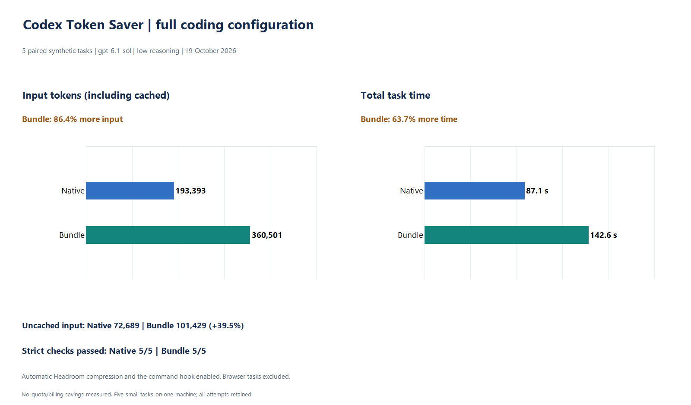

# Native Codex / Token Saver: full coding configuration

Run started 2026-10-19T13:58:02.036265+00:00. Five synthetic paired tasks on one Windows laptop.
Requested model: `gpt-6.1-sol`; reasoning: `low`;
CLI: `codex-cli 0.163.0-alpha.10.2`; Windows: `10.0.26200` (AMD64).

[Raw results](overall-repeat-windows.json) · [Frozen tasks, hashes and rubric](overall-repeat-windows.manifest.json)

Configuration: **Full coding configuration**.

## Results

| Task | Native grade | Bundle grade | Native input | Bundle input | Native seconds | Bundle seconds |
|---|---|---|---:|---:|---:|---:|
| log-diagnosis | Pass | Pass | 43,571 | 62,630 | 12.178 | 18.256 |
| symbol-tracing | Pass | Pass | 40,574 | 106,424 | 13.956 | 25.385 |
| structural-audit | Pass | Pass | 40,549 | 46,825 | 12.690 | 18.433 |
| tested-code-fix | Pass | Pass | 41,782 | 87,662 | 39.131 | 60.333 |
| patch-review | Pass | Pass | 26,917 | 56,960 | 9.183 | 20.209 |

| Total | Native | Bundle |
|---|---:|---:|
| Passed tasks | 5 | 5 |
| Input tokens (including cached) | 193,393 | 360,501 |
| Cached input tokens | 120,704 | 259,072 |
| Uncached input tokens | 72,689 | 101,429 |
| Output tokens | 1,754 | 2,622 |
| Wall seconds | 87.138 | 142.616 |

Signed input-token reduction: **-86.41%** (negative means more input with the bundle).
This is reported model input, including cached tokens, across all attempts; failed tasks remain included.
No weekly quota or billing reduction was measured.

## Tool use and quality

The bundle made 8 MCP calls; 1 reported failures.
Native commands remain available in both arms. Tool availability does not imply a call to every component.

Uncached input change: **+39.54%**.
Wall time change: **+63.67%**.
Cache mix differs between arms; these percentages are not interchangeable with cost or quota.

The fixed rubric checks exact structured answers and unchanged fixtures; the code fix also passes
an independent hidden oracle. Final answer prose, command output and credentials are not published.
Exact-answer failures do not, by themselves, prove a semantic error or a bundle regression.

## Scope and limitations

- Explicit tools, automatic Headroom request compression and the reviewed command hook enabled. Browser tasks and other clients excluded.
- Fresh native-provider sessions and separate identical Git fixtures; deterministic randomized arm order.
- Same model, reasoning setting and permissions in both arms. Plugins, connected apps and multi-agent work disabled.
- Execution mode: `danger-full-access`. Temporary synthetic directories are not a VM or security boundary.
- Reported latency includes CLI/MCP startup and model time. Shared workers and provider caches were not flushed.
- All attempts are retained; zero manual retries within this frozen study. Internal network retries are not measured.
- This small sample cannot establish statistical equivalence or predict savings on larger real repositories.
- Daily authentication/configuration unchanged: `True`. VM tests remain paused.

Component versions: headroom `0.40.0`, serena `2.0.0`, laya `0.4.6`, rtk `rtk 1.0.0`, ast-grep `ast-grep 0.50.0`.

## Automatic-path evidence

5 connections routed to Headroom; 38 direct connections; 5 relay failures.
Command hook: 2 rewrites and 6 skips attributed to the benchmark chats.
A routed connection is not proof of a positive compression event. Direct connections can include metadata requests.
Relay failure counts can include abrupt client socket shutdown; they do not prove failed model tasks or request retries.
Shared-backend savings estimates are not attributed to these tasks or added to model usage.
The temporary production relay used a separate loopback port and the existing warm backend.
Only the reviewed production hook bypassed trust in temporary CLI profiles; no daily hook trust was changed.
