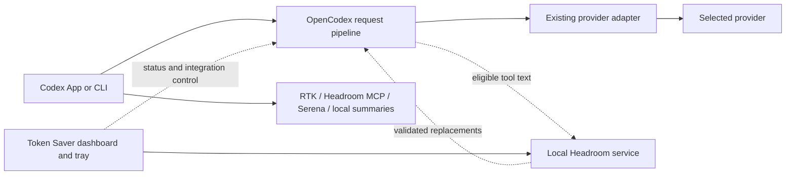

# OpenCodex compatibility design

Date: 2026-09-27. Status: proposed architecture; no product implementation or live routing changes.

## Decision

Keep **OpenCodex responsible for provider routing** and **Token Saver responsible for optional local optimization**. Add an explicit OpenCodex integration that calls the bundle's Headroom service for compression without sending model requests through a second routing proxy.

This requires a small integration in OpenCodex as well as bundle changes. A compatible upstream release is preferred. A separately identified, pinned OpenCodex build is a possible pilot, not an unannounced replacement of the installed app. No suitable existing extension contract was established in this investigation; the interface below is proposed, not a feature available in OpenCodex 2.64.0.

The intended outcome is one bundle that works with native Codex and OpenCodex, retaining all controls, selected models and reasoning, exact retrieval, history, updates, and recovery. Experimental local summaries remain optional and do not replace either client's compaction.

## Evidence and current gaps

Inspected Token Saver revision `5ca50f7`, installed OpenCodex `2.64.0`, and corresponding upstream tag commit `4cb43cb0a8c6b60318cf0d63ffa8e57fd18407b2`. The local OpenCodex configuration lists OpenAI, Azure OpenAI, and LM Studio; its configured port is 10100. Configured providers are not evidence of successful live requests.

| Finding | Consequence |
|---|---|
| `desktop_proxy_control.py::_check_routes` rejects custom providers/endpoints. | Merely enabling the existing request control cannot provide OpenCodex compatibility. |
| `desktop_proxy.py::resolve_upstream` infers OpenAI destinations from credentials. | It must never choose a destination for an OpenCodex-routed model. |
| OpenCodex injects catalog, endpoint, voice, and sometimes provider-table settings. | Two independent config writers would conflict. |
| OpenCodex preserves a user-owned root endpoint, but then skips its managed voice override and native subagent-default injection. | A simple `Codex → Token Saver → OpenCodex` chain is incomplete even if ordinary chat works. |
| `launch_codex.py::find_codex` locates the native runtime directly. | The bundle launcher can bypass OpenCodex's shim/startup behavior. |
| RTK checks Codex session environment; MCP tools register in Codex's configuration. | These features primarily depend on the client/runtime, not the selected model provider. Verify the actual OpenCodex-launched environment. |

The inspected Codex config currently contains the existing Token Saver endpoint at port 8788. Do not treat that file alone as proof of the route loaded by this running chat.

## Alternatives

| Approach | Assessment |
|---|---|
| **OpenCodex calls a local compression service** | Recommended. One routing owner; consistent provider/auth/voice handling; requires an OpenCodex integration. |
| Token Saver gateway before OpenCodex | Potential bounded prototype. Needs new upstream rules, WebSocket handling, and coordinated ownership for voice, profiles, and subagents. Not the seamless default. |
| Headroom behind every OpenCodex provider | Reject. Duplicates provider credentials, dialects, endpoint management, and failure policies. |

## Architecture

Native mode retains the existing 8788 relay and 8789 backend. OpenCodex mode uses the Headroom runtime as a **transformation-only service**: it has no authority to select a provider, forward authorization, or dispatch a model request. Reuse the existing managed worker where practical; advertise its supported transform contract separately from proxy readiness. Avoid loading another Kompress model just for OpenCodex.

OpenCodex inserts the call at its canonical outbound request preparation boundary, after history/replay reconstruction and before provider serialization. `src/server/responses/` is the inspected integration area; the exact call site must be proven to cover HTTP, WebSocket, native-forward, and translated adapter paths. The `prepareAdapterExchange` function alone is not assumed to cover them all.

Keep original history and OpenCodex's persisted response state unchanged. Apply replacements only to an outbound copy. For server-retained history or WebSocket deltas, compress only eligible tool text actually present; do not invent history or claim reduction of context retained remotely. Unsupported paths bypass compression until qualified.

## Proposed contract and invariants

Add an authenticated, versioned loopback endpoint such as `POST /v1/transform/tool-results` and a read-only capability endpoint. Names are proposed API design. Bind to loopback, reject redirects/environment proxies, authenticate with a bundle-local token protected by the user's Windows ACL, and never expose it in dashboard output.

Request fields: protocol version, opaque request/scope identifiers, deadline, and a bounded list of `{id, original_sha256, text}` entries. OpenCodex selects only supported textual tool-result fields. Do not send provider credentials, URLs, system/developer/user messages, full tool schemas, image/audio bytes, encrypted reasoning, or unrelated metadata.

Return `{id, original_sha256, replacement, retrieval_reference}` entries plus outcome/timing/estimate metadata. OpenCodex accepts replacements only for submitted IDs with matching hashes and bounded sizes. No arbitrary JSON patches, role changes, item deletion, reordering, or changes to call IDs/tool arguments. Invalid responses leave the complete request unchanged.

The bundle service must:

- Reuse the coding compression policy and existing exact-response receipt verification, including nested `functions.exec` envelopes and Serena exact bodies.
- Protect authenticated exact results before compression or deduplication. Unrecognized structured/multimodal outputs pass unchanged; a text-only compressor must not flatten their structure.
- Detect existing compression markers and avoid another lossy pass over them. Compress original text independently per request, with a bounded scope-and-content cache to stabilize repeated history.
- Persist recoverable originals before returning a replacement. Reuse the existing retrieval bridge and reference formats where compatible; version the contract if storage changes. Returning `headroom_retrieve` results must always preserve exact bytes.
- Apply replacements only when smaller after recovery instructions are included. A token estimate is not an invoice or a guarantee of lower provider cost.
- Advertise readiness only after model warmup, retrieval availability, and exact-protection checks. Retrieval must remain usable while compression is paused.

Use a bounded initial deadline (proposed 500 ms per request, measured before qualification), bounded concurrency, cancellation, and a circuit breaker. Cold/unavailable/overloaded compression immediately passes through original text. Slow compression may yield little benefit; tune from measurements instead of increasing latency silently.

Run transformation once per logical outbound content version. Reuse that decision for OpenCodex's existing retries; recompute only when a new content version is intentionally prepared. The integration creates no additional provider retry, account fallback, or model/effort downgrade. Abort and failure after dispatch retain OpenCodex's existing semantics.

## Full-bundle behavior

| Capability | Required OpenCodex behavior |
|---|---|
| RTK and automatic command output | Preserve PATH, literal argv, exit codes, Codex session variables, exact bypasses, and execute-once behavior. Hook trust remains Codex-controlled. |
| Headroom file tools | Register against the effective `CODEX_HOME`; keep optional MCP startup and exact retrieval. |
| Serena | Preserve four read-only tools, per-session project state, live toggle, and native fallback. No second registration. |
| Headroom request compression | Use the proposed transform integration; preserve OpenCodex model, provider, auth, voice, catalog, and routing policy. |
| LangMem and llama.cpp | Retain explicit jobs, cancellation, saved summaries, and local inference controls. Read supported Codex rollout formats; expose incompatible OpenCodex compaction records as unsupported/incomplete rather than rewriting history. |
| Dashboard and tray | Show integration mode, detected versions, requested/ready/recent-use states, and exact bypass reasons. Existing independent component toggles remain. |
| Startup and launcher | Retain native mode. In OpenCodex mode use the installed, documented shim/runtime launch path; do not call a guessed newest native executable or recurse through the bundle launcher. |
| Updates and disable | Validate the OpenCodex/Headroom contract, retain rollback, remove only bundle-owned entries, and keep OpenCodex operational when Token Saver is disabled. |

Add a small integration adapter behind `BundleControls`, with native and OpenCodex implementations. Reuse component management; do not build a second dashboard or generic plugin framework. Likely bundle touchpoints: `bundle_controls.py`, `desktop_proxy_control.py`, `proxy_runtime.py`, `desktop_proxy_service.py`, `launch_codex.py`, install/repair/disable scripts, dashboard status, and package smoke tests.

## Configuration, switching, and recovery

Discovery is read-only: resolve installed `ocx`, its version/capabilities, effective config home, and readiness using documented machine-readable commands. A port listener or the existence of `.opencodex` is insufficient proof of active integration. Do not fetch whole credential-bearing config documents into diagnostics.

OpenCodex owns its provider/catalog/voice settings, config journal, credentials, and lifecycle. Token Saver owns its component settings, optimization service, MCP blocks, and integration receipt. Configure the proposed extension through OpenCodex's validated configuration API/CLI; do not hand-edit its JSON or database. Capability detection is required before enabling.

Migration is a reversible state machine:

1. Preflight both versions, actual active configuration/profile, endpoint ownership, and selected model/effort. Prepare a scoped backup and receipt.
2. Warm and validate the transform service without changing routing. Verify retrieval in the same effective Codex tool configuration.
3. Drain affected work. Restore only the existing bundle-owned native endpoint using its receipt, then invoke OpenCodex's supported integration control. Treat these as separate recoverable transactions, not one atomic cross-application write.
4. Re-read configuration and reject unexpected model, effort, provider identity, history, or unrelated changes. OpenCodex setup can have broader effects; do not promise preservation based only on the bundle's write scope.
5. Enable the extension only after OpenCodex readiness and an isolated end-to-end witness pass. Retain the old relay until old connections have drained. Report any client reload requirement.

If the operation fails midway, leave a recoverable receipt and restore only values still owned by that transaction. Concurrent external edits produce a conflict, never a wholesale stale-file restore. Do not migrate active chat history or automatically restart Codex.

In OpenCodex mode **Pause request compression** disables the extension and preserves provider routing. **Disconnect Token Saver** removes the extension and owned local-tool integration without calling `ocx stop`/`restore`, which can change native routing. Existing **Restore Codex Direct** is explicitly a switch away from OpenCodex, not the default compressor recovery action.

Existing OpenCodex 2.64.0 without the extension can use compatible local bundle features; report request compression as **Unavailable: OpenCodex integration required**. Do not display full compatibility until the native extension is qualified. Remote hubs and authless/provider-table modes require separate qualification; no silent global workaround.

## Validation and delivery

Start with isolated configs, fake provider endpoints, deterministic fixtures, and no paid model calls. Implement the two adapters and the local protocol, then prove:

1. Enable, pause, repair, uninstall, rollback, and interrupted migration preserve model/effort, auth, unrelated settings, and task history. Include external config edits, both installation orders, nondefault ports, profiles, and `CODEX_HOME`.
2. HTTP/SSE and WebSocket tool turns preserve tool-call pairing, cancellation, streaming, and retry counts. Cover full history, deltas, reconnects, concurrent chats, and native-forward paths.
3. Exact retrieval survives nested envelopes, provider translation, Unicode, disabled compression, cache expiry, and restart. No compressed marker is emitted without a usable original. Test protected tool outputs from both Headroom and Serena.
4. Voice, catalog refresh, native subagents, images, and `/responses/compact` continue on existing OpenCodex routes. Compression skips unsupported payloads and leaves their semantics intact.
5. Compressor failure, malformed output, overload, or version mismatch sends the original request through OpenCodex exactly as before, with no new provider dispatch.
6. Windows launch, clean shutdown, actual reboot/login, package upgrade, and complete bundle disable behave correctly. Check memory for duplicate runtimes and preservation of OpenCodex's shim.

Only then run a bounded real workflow on the configured OpenAI, Azure OpenAI, and LM Studio routes that have valid credentials/models. Compare compression off/on with fixed inputs, selected model/effort, task correctness, provider token usage, cache behavior, elapsed time, and retrieval overhead. Provider translation can invalidate naive token estimates; passing mock tests is not release qualification.

Deliver in three increments: (1) coexistence detection/local features and honest status; (2) versioned Headroom service plus OpenCodex extension; (3) Windows packaging and the qualification matrix. A small upstream PR is preferable to maintaining an OpenCodex fork. If that integration cannot be shipped, deliver increment 1 as partial compatibility rather than describing a proxy chain as seamless.

Keep RTK/local-output/request estimates separate. Add OpenCodex integration activity and provider-observed usage without summing overlapping counters. The user's 5% weekly quota cap applies to this design investigation; no implementation budget is assumed. The shared whole-percent weekly meter reported 0% at the start and investigation checkpoints; it cannot attribute exact task consumption or provider-specific spending.

## Source references

- Token Saver: [request routing](../../../DESKTOP-REQUEST-PROXY.md), [bundle controls](../../USING-BUNDLE.md), [Serena](../../SERENA-INTEGRATION.md); exact local functions named above were inspected.
- OpenCodex 2.64.0: [Codex integration](https://github.com/lidge-jun/opencodex/blob/4cb43cb0a8c6b60318cf0d63ffa8e57fd18407b2/docs-site/src/content/docs/guides/codex-integration.md).
- OpenCodex: [endpoint preservation and voice ownership](https://github.com/lidge-jun/opencodex/blob/4cb43cb0a8c6b60318cf0d63ffa8e57fd18407b2/src/codex/inject/config-toml.ts), [injection and subagent behavior](https://github.com/lidge-jun/opencodex/blob/4cb43cb0a8c6b60318cf0d63ffa8e57fd18407b2/src/codex/inject/plan.ts), [routing targets](https://github.com/lidge-jun/opencodex/blob/4cb43cb0a8c6b60318cf0d63ffa8e57fd18407b2/src/codex/inject/routing-target.ts).
- OpenCodex: [adapter dispatch boundary](https://github.com/lidge-jun/opencodex/blob/4cb43cb0a8c6b60318cf0d63ffa8e57fd18407b2/src/server/responses/adapter-dispatch.ts). This is source evidence for existing responsibilities, not proof of an extension hook.

Web search/page tooling failed during research. Upstream sources were fetched directly from GitHub at the pinned tag; recommendations above are design inferences from those sources and the local bundle, not live compatibility test results.
